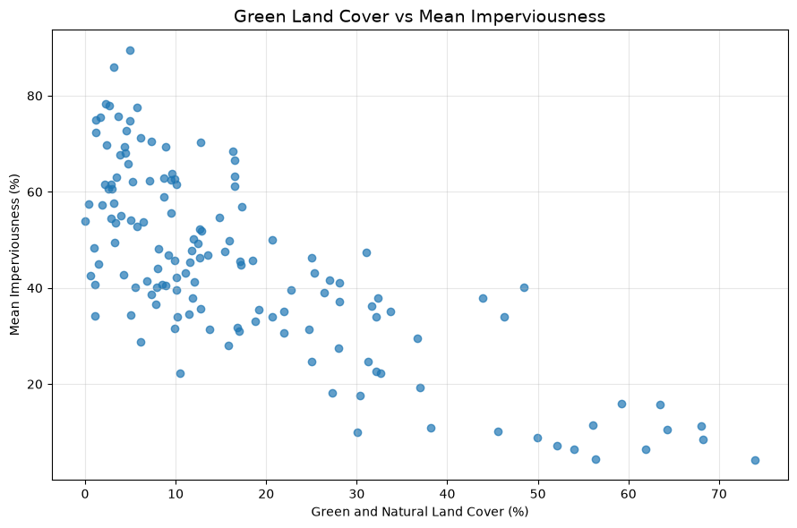
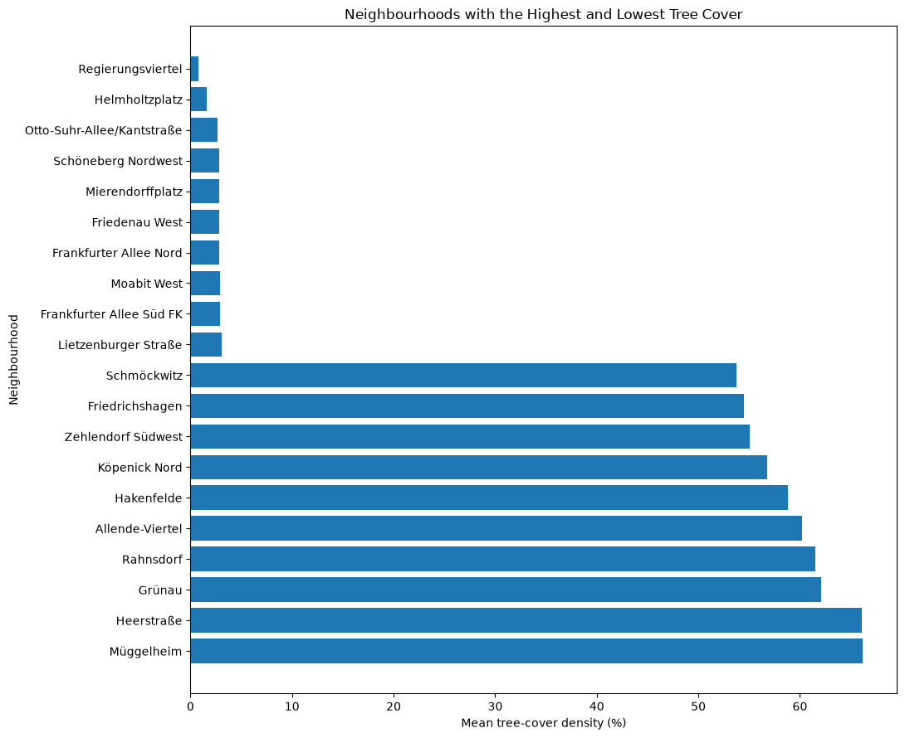
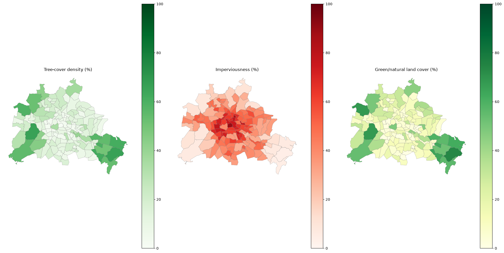
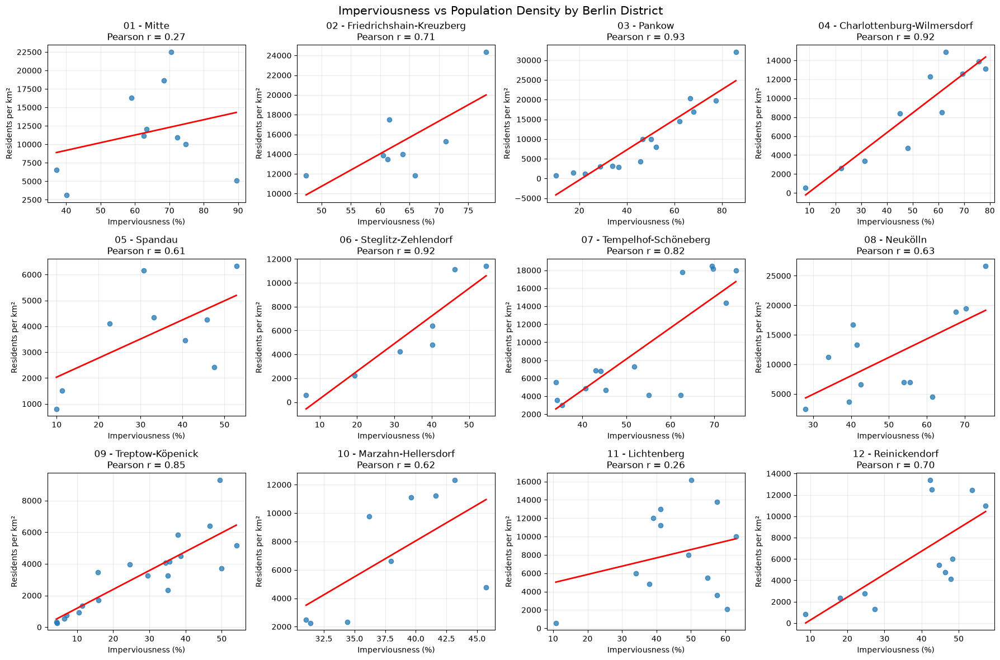
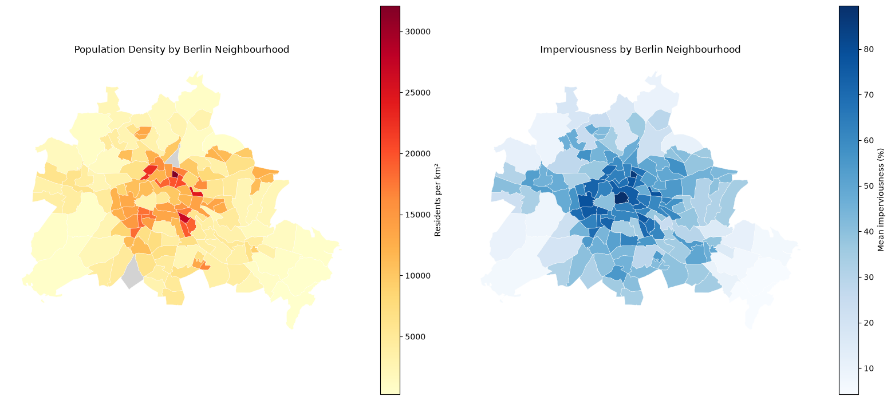
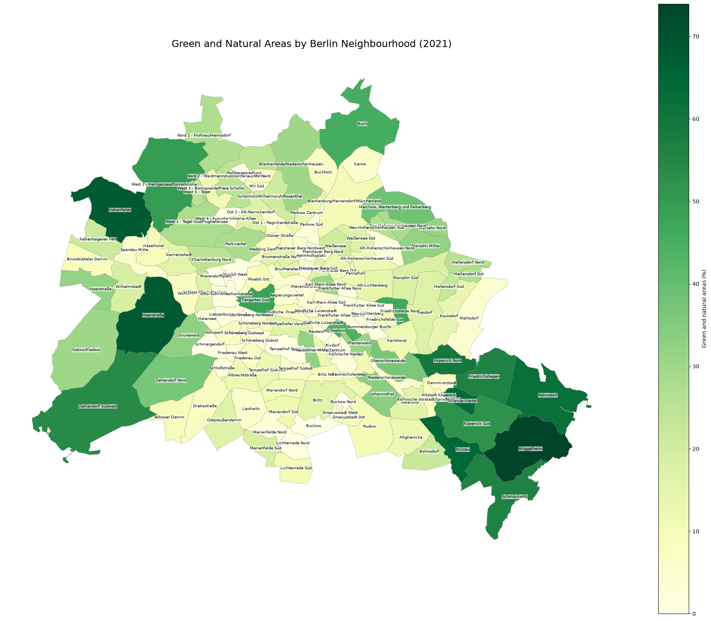

## Conceptual Model — Berlin Summer Heat and Urban Environment

### Project objective

To investigate how summer heat conditions in Berlin changed between 20xx (still need to define how long in the past I can go) and 2026, explore their relationship with air and bathing-water quality, and examine how urban characteristics and population distribution may influence potential heat exposure across Berlin neighbourhoods.

Also, provide an overview on water/electricity consumption up to 2025

### Conceptual framework

The project is structured around four points:

1. Heat conditions

- Daily maximum, minimum and average temperatures

- Number of hot days (≥30°C)

- Number of very hot days (≥35°C)

- Duration of consecutive hot days

- Comparison between summer 20xx and summer 2026

2. Environmental conditions

- Air quality: ozone, particulate matter and nitrogen dioxide

- Bathing-water quality: water temperature, bacterial indicators and cyanobacteria-related measurements

- Comparison of air-quality measurements on hot and non-hot days

3. Urban characteristics

- Tree-cover density

- Imperviousness (sealed surfaces)

- Green and natural land-cover share

- Population density

4. Population exposure — neighbourhood context

- Population distribution across Berlin neighbourhoods

- Identification of densely populated neighbourhoods with high imperviousness and relatively low vegetation indicators

- Exploration of where potentially higher heat exposure could coincide with larger residential populations

### Expected analytical relationships

- Higher temperatures may coincide with changes in air quality.

- Heat and rainfall conditions may be relevant context when interpreting bathing-water measurements.

- Neighbourhoods with higher imperviousness and lower vegetation indicators may have characteristics associated with greater heat exposure.

- Population density helps identify where these urban characteristics may affect more residents.

### Project limitations

-Weather and air-quality stations provide measurements at specific locations, not for every neighbourhood.

-Neighbourhood-level urban indicators describe land cover and population, not directly measured neighbourhood temperatures.

-Bathing-water measurements are periodic samples, not continuous daily observations.

-Observed relationships will be treated as associations, not proof of causation.

## Stand up 5/11/2026

## Conceptual model

How summer heat conditions in Berlin have evolved over time, how they relate to environmental conditions and resource consumption, and how urban characteristics may influence potential population exposure.

- Measure the heat: Compare summers from 20xx (need to define according to the historical data I will be able to find) until 2026 using temperature, hot-day frequency and heat duration (pressure, wind and rain could also be metric to check).

- Explore environmental conditions: Analyse air-quality measurements during hot vs non-hot days and examine bathing-water quality across selected lakes.

- Analyse historical water and electricity consumption trends: check how they changed during hot vs non hot days.

- Assess urban characteristics: Compare Berlin neighbourhoods using tree cover, imperviousness, green land cover and population density.

- Bring the findings together: Identify patterns between heat, environmental conditions and urban characteristics to explore where potential heat exposure may be more relevant for residents.

### KPIs

#### Heat conditions

- Hot days - Number of days with maximum temperature ≥30°C
- Extreme hot days - Number of days with maximum temperature ≥35°C
- Heat duration - Longest consecutive period with maximum temperature ≥30°C
- Average temperature - Mean daily maximum and average temperature (°C)

#### Air quality

- Pollutant levels - Mean concentrations of O₃, PM2.5, PM10 and NO₂ (µg/m³)
- Hot vs non-hot days - Difference in mean pollutant concentrations between the two groups

#### Bathing-water quality 

- Water temperature - Mean measured temperature (°C)
- Bacterial indicators - E. coli, Cyanobacteria, Coliform bacteria and intestinal enterococci (CFU/100 ml)
- Water-quality exceedances - Percentage of valid samples exceeding applicable thresholds

#### Urban characteristics & population

- Population density - Residents per km²
- Tree cover - Mean tree-cover density (%)
- Imperviousness - Mean imperviousness (%)
- Green/natural land cover - Share of selected land-cover classes (%)

#### water/electricity consumption trends

- Consumption average -average consumption throughout the years (20xx to 2026)
- Consumption peaks - compare consumption during hot/non hot days

### Progresses so far:
- Data dictionary (mostly complete)
- Most data for 2025/2026 cleaned/merged/ordered and ready for analysis
- Better defined scope of analysis/objectives
- Few visualizations created with spatial data

### Challenges:

- Retrieve and create model for historical data prior to 2025 for electricity/water/meteo/satellite data
- Keep track of progresses being achieved through complex coding
- Manage many different datasets in different formats with different metrics

### Early visualizations:
#### Possible correlation between imperviousness and green land cover

#### Top/bottom 10 neighbourhoods based on tree coverage:

#### Tree coverage-soil sealing-green/natural land cover comparison

### Possible correlation soil sealing-population density per district

### Population density vs soil sealing comparison

### Green areas with Berlin neighbourhoods

